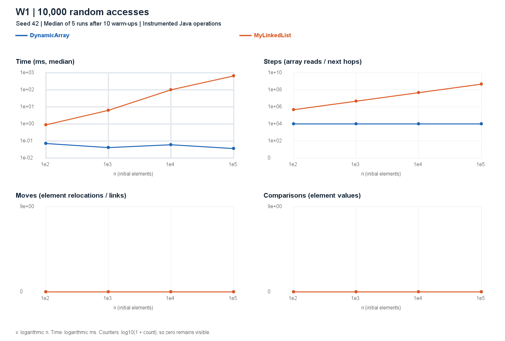
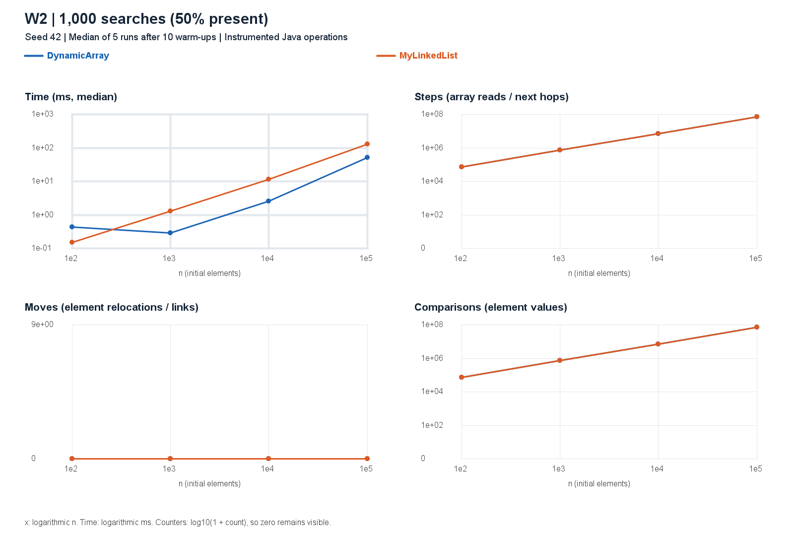
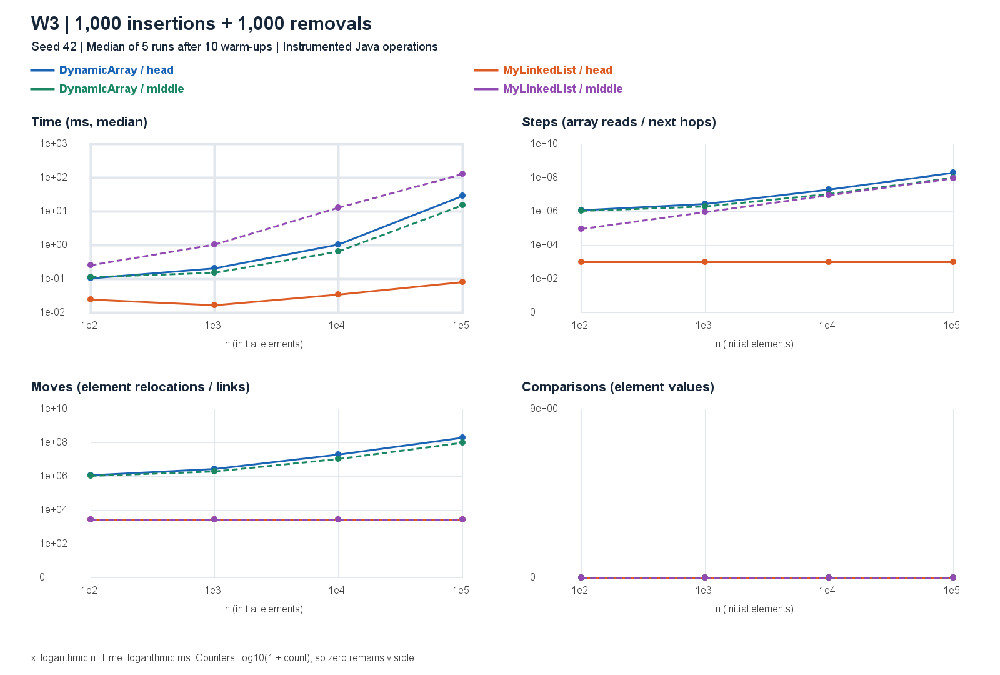
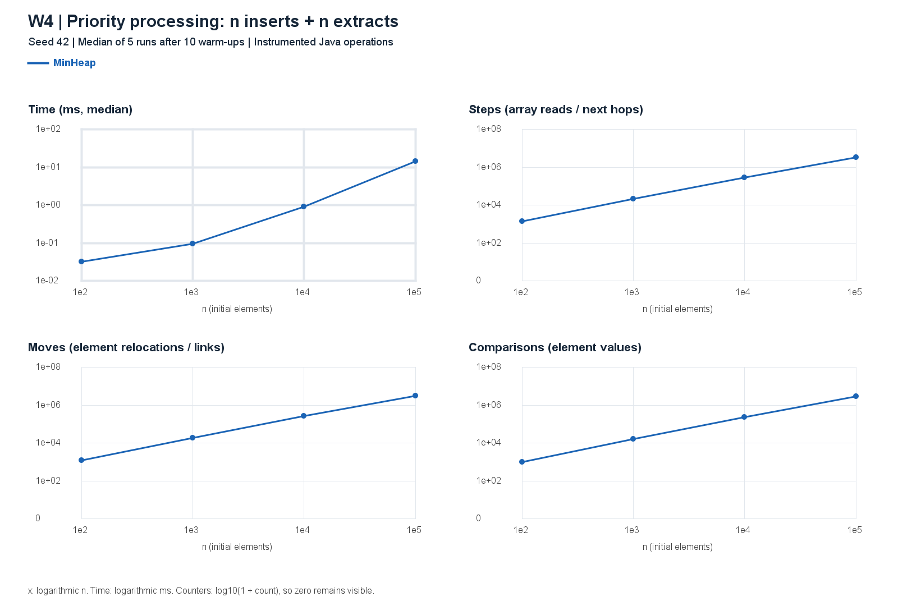
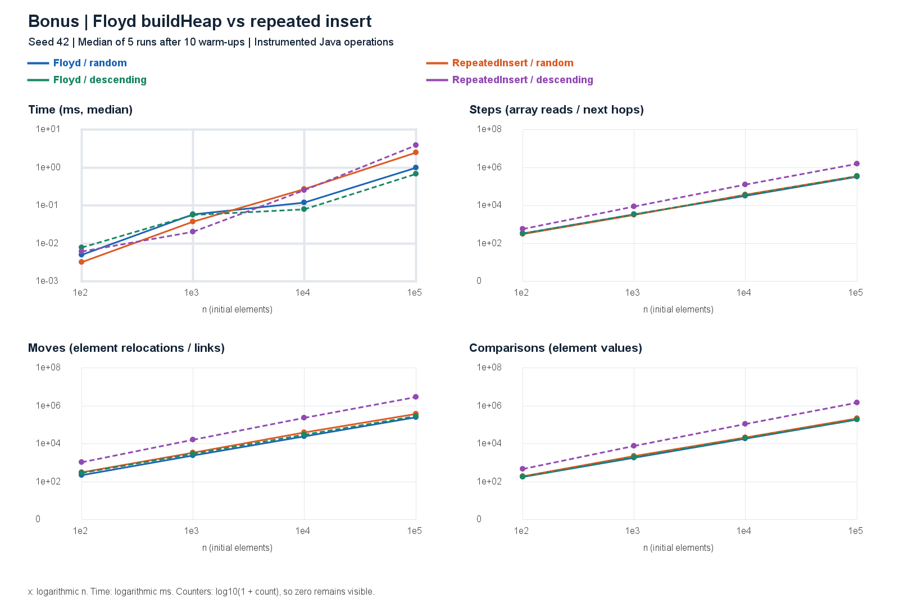

# Assignment 2 - Data Structures

Akmaral Abilkhaiyr | SE-2518 | Design and Analysis of Algorithms

## 1. Design, method and complexity

`DynamicArray` and `MinHeap` store `int[]` with initial capacity 8 and doubling growth. `MyLinkedList` is singly linked, with `int` node values and head/tail pointers. Both sequences implement `IntSequence`. Production code contains no standard collection or boxed element storage. Capacity is retained after removals. Let `n` denote the current size and `C` the allocated capacity; total array/heap storage is Θ(C), and list storage is Θ(n). During insertion-only growth, C = Θ(n + 1); after removals it reflects the historical maximum.

All bounds below concern valid operations; invalid input throws in Θ(1). Average indexed-operation bounds assume a uniformly selected valid index. Search assumes uniform hit position or a constant probability of a miss. Heap averages assume random-order distinct keys; adversarial order can differ. Auxiliary space is additional live memory during one call, excluding existing storage and including any new backing array/node.

| Structure / operation | Best | Average | Worst | Aux. worst | Justification |
|---|---|---|---|---|---|
| Array `add(x)` | Θ(1) | Θ(1) amortized | Θ(n) | Θ(n) | Geometric copies total Θ(m) over m appends; one resize copies n. |
| Array `add(i,x)` | Θ(1) | Θ(n) | Θ(n) | Θ(n) | Shift n-i entries; growth can also copy n. |
| Array `remove(i)` | Θ(1) | Θ(n) | Θ(n) | Θ(1) | Shift n-i-1 entries; no shrinking. |
| Array `get(i)` | Θ(1) | Θ(1) | Θ(1) | Θ(1) | One indexed read. |
| Array `contains(x)` | Θ(1) | Θ(n) | Θ(n) | Θ(1) | Stop at first match or scan all n values. |
| List `add(x)` | Θ(1) | Θ(1) | Θ(1) | Θ(1) | Tail pointer avoids traversal; allocate one node. |
| List `add(i,x)` | Θ(1) | Θ(n) | Θ(n) | Θ(1) | Head/tail are special cases; middle visits predecessor. |
| List `remove(i)` | Θ(1) | Θ(n) | Θ(n) | Θ(1) | Head is direct; other positions need predecessor traversal. |
| List `get(i)` | Θ(1) | Θ(n) | Θ(n) | Θ(1) | Exactly i next-link traversals, Θ(i+1) runtime. |
| List `contains(x)` | Θ(1) | Θ(n) | Θ(n) | Θ(1) | Compare sequential nodes until match or null. |
| Heap `insert(x)` | Θ(1) | Θ(1) expected amortized* | Θ(n) | Θ(n) | Sift up is O(log n); a resizing call copies n. |
| Heap `peekMin()` | Θ(1) | Θ(1) | Θ(1) | Θ(1) | Root read without mutation. |
| Heap `extractMin()` | Θ(1) | Θ(log n) | Θ(log n) | Θ(1) | Replacement may stop at root or descend the height. |
| Heap `buildHeap(a)` | Θ(n) | Θ(n) | Θ(n) | Θ(n) | Defensive copy plus bottom-up sifts. |

*For random-order insertions, expected sift distance is bounded; amortization spreads resize copies over the sequence. Without a probability model the safe per-insert amortized upper bound is O(log n), with Ω(1) lower bound. A full-capacity call has Θ(n) average and worst time due to copying, regardless of key order. Without growth, insertion's worst case is Θ(log n). Here Θ means matching O and Ω bounds. Auxiliary space of non-growing array/heap insertions is Θ(1); utility `size()`/`metrics()` calls are Θ(1). Diagnostic `toArray()` is Θ(n) time and extra space.

### Measurement protocol

For each n in {100, 1,000, 10,000, 100,000}, `new Random(42)` generates nonnegative values in [0, 1,000,000), then shared access indices and search queries. There are 10 discarded warm-ups and five measured fresh structures per case. CSV time is the median; raw samples and environment are retained. W1 makes 10,000 accesses; W2 makes 1,000 searches, exactly 500 guaranteed hits and 500 guaranteed negative misses. W3 performs all 1,000 insertions before all 1,000 removals at head or the fixed initial n/2 index. W4 times n inserts and n extracts, then validates nondecreasing output outside timing. W1-W3 setup is excluded, while growth during measured operations is included. Counters and output checksums are observable; counters/checksums must match across repetitions. Times include instrumentation, and this is a single JVM process, not a multi-fork JMH experiment.

## 2. Correctness proofs and counters

### Proof A: `DynamicArray.contains`

**Invariant.** Before iteration i, 0 ≤ i ≤ size, and every position j in [0, i) contains a value different from the searched value; the array and size are unchanged.

**Initialization.** At i=0 the examined prefix is empty, so the statement is vacuously true.

**Maintenance.** Read `data[i]`. If it equals the value, returning true is justified by that witness. Otherwise all positions in [0, i+1) differ from the value; incrementing i preserves the invariant.

**Termination.** The variant size-i decreases by one on each continuing iteration. If the loop exhausts at i=size, the invariant covers every stored position, so returning false is correct. For an empty array, the same conclusion holds immediately.

**Conclusion.** The method returns true exactly when a stored element equals the query and never changes the sequence.

### Proof B: `MinHeap.bubbleDown`

**Precondition.** For the invocation's root r, its left and right subtrees are heaps; only r's outgoing edges may be unordered. Extraction establishes this after moving the last value to the root. Bottom-up construction establishes it because children are processed before parents.

**Invariant.** Within the subtree rooted at r, all parent-child edges except those from the current index are ordered, and its multiset is unchanged. The cached `value` equals the value at the current index. If the current index is below r, its parent is no greater than every value in its subtree.

**Initialization.** The current index is r. Both child subtrees are heaps by the precondition; the ancestor condition is vacuous, and reading the root changes no value.

**Maintenance.** Select the smaller child, including the one-child case. If `value` is greater, swapping places the smallest of the parent and both child roots at the old index. The previously valid subheaps show that this promoted value is no greater than any value below it. The ancestor condition prevents a violation above the swap. Only the demoted value's outgoing edges can now violate order, so descending to that child preserves every part of the invariant.

**Termination.** Each swap moves one level downward in a finite tree. At a leaf there is no outgoing edge to repair. If `value <= childValue`, it is no greater than either child and the invariant already guarantees all other edges. Thus the complete subtree rooted at r is a heap.

**Conclusion.** Bubble-down restores heap order while preserving the multiset. Hence extraction removes precisely the old minimum, and Floyd's decreasing-parent loop builds a correct heap.

### Counter interpretation

Steps count array-cell reads or following a list next link, including a hop to null. Moves count existing-value relocations (growth copies and two writes per heap swap) or explicit `head`, `tail`, `next` assignments. New input storage in an array is not a relocation; Floyd's defensive copy is counted. Comparisons count element-value comparisons only. Node value reads, local variable assignments, bounds checks, allocations and reference comparisons are outside the specified model. Consequently list `get(0)` has zero steps but nonzero constant runtime, and list W3 head still records 3,000 link updates rather than falsely reporting zero work. `toArray()` is diagnostic and uninstrumented. JUnit verifies exact small examples as well as random correctness; all 18 tests passed.

## 3. Random access and search results

Each chart has time, steps, moves and comparisons panels, with shared series for both structures. The n axis and time axis are logarithmic; count panels use log10(1+count) to retain zeros. Counters are deterministic physical operations, not CPU instructions. Very short cases can still be affected by JIT compilation, timer granularity and scheduling even after warm-up; no monotonic timing trend is forced or fabricated.

At n=100,000, W1 takes 0.0372 ms for the array and 674.2536 ms for the list. The decisive evidence is 10,000 array reads versus 504,930,938 next-link traversals; the timing ratio itself is machine-dependent.

At n=100,000, both structures perform 73,970,266 element comparisons. Times are 52.8412 ms for the array and 132.0923 ms for the list. The list has exactly 500 fewer steps because each successful search returns without following the matching node's next link.

## 4. Mutation and priority-processing results

At n=100,000, head mutation takes 29.3270 ms for the array versus 0.0827 ms for the list; middle mutation takes 15.5675 ms versus 131.0665 ms. Head array moves total 200,999,000; middle moves total 100,999,000. List head uses 1,000 steps and 3,000 moves; list middle uses 99,999,000 steps and 3,000 moves. For smaller n, growth copies can add array moves because all insertions precede removals.

At n=100,000, heap insertion plus full extraction takes 14.5899 ms, with 3,059,125 comparisons. Every run validates sorted output. W4 has one series because this workload is assigned only to MinHeap; its expected random-data total is Θ(n log n), with O(n log n) worst-case total and Θ(n) possible for all-equal keys.

## 5. Discussion and bonus

1. DynamicArray reaches a random index directly, whereas this singly linked list follows every preceding next pointer.
2. Consecutive primitive ints share cache lines, so array scans benefit from spatial locality and hardware prefetching.
3. A list node can reside elsewhere in memory, and obtaining the next address depends on reading the current node.
4. This pointer dependency can limit overlapping memory reads and explains why equal asymptotic bounds need not imply equal times.
5. W2 provides the clearest example: equal comparison counts at n=100,000 accompany about 2.50 times longer list execution.
6. Object headers, alignment and reference fields increase list memory traffic beyond the stored four-byte integer.
7. Node allocations also create garbage-collector work, though this experiment does not separately measure collection time or cache misses.
8. Head insertion and removal favor the list because a few pointer updates replace shifting almost the entire array.
9. Middle insertion is not constant-time through an index-based list API because locating the predecessor is linear.
10. The tail pointer makes append constant-time, but removing the tail still requires finding its predecessor.
11. A heap is preferable for repeatedly scheduling the smallest-priority job because it maintains the minimum without fully sorting after each update.
12. These explanations are consistent with the measurements, but timings also include counter updates, JIT effects and operating-system noise, so they do not prove a specific hardware cause.

### Bonus B: bottom-up construction

Floyd processes internal nodes from right to left. At most O(n/2^(h+1)) nodes have height h, giving total sift work O(n Σ h/2^h)=O(n); reading/copying n inputs supplies Ω(n), hence Θ(n). Repeated insertion costs O(n log n) in the worst case, attained by descending distinct keys; random-order insertion can take expected Θ(n) total and should not be presented as always Θ(n log n).

At n=100,000, descending data needs 199,978 comparisons with Floyd and 1,468,946 with repeated insertion (0.6782 vs 3.9162 ms). Random data needs 188,424 and 227,662 comparisons (1.0095 vs 2.5188 ms). Both methods' outputs are fully extracted and checked after timing. Bonus A/JOL memory measurements are not included; the memory discussion is qualitative, not a claimed measured footprint.

The source, measurements, plots and report are versioned on `main` with feature branches and release tag `v1.0`. Runtime metadata is in `results/environment.txt`. This report describes the committed run; rerunning the benchmark changes measured times.
